# Class Activity 1 — System Calls in Practice

- **Student Name:** SUN SOVISAL
- **Student ID:** e20230105
- **Date:** 2026-10-14

---

## Warm-Up: Hello System Call

Screenshot of running `hello_syscall.c` on Linux:

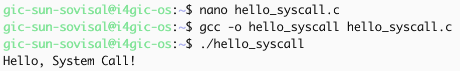

Screenshot of running `copyfilesyscall.c` on Linux:

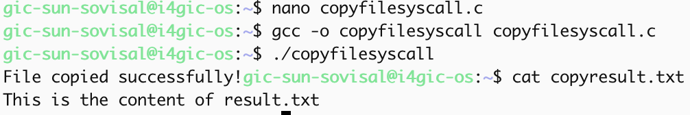

---

## Task 1: File Creator & Reader

### Part A — File Creator

**Describe your implementation:** The library version uses `fopen` / `fprintf` / `fclose` / `printf`. The system call version does the same work with `open`, `write`, and `close`, and prints the confirmation with `write(1, ...)`. Both create `output.txt` with the same text and print the same success message.

**Version A — Library Functions (`file_creator_lib.c`):**

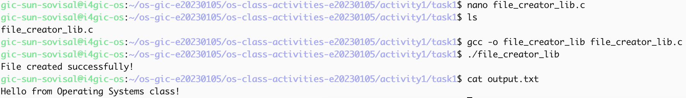

**Version B — POSIX System Calls (`file_creator_sys.c`):**

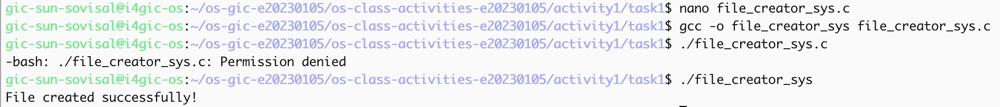

**Questions:**

1. **What flags did you pass to `open()`? What does each flag mean?**

   > I used `O_WRONLY | O_CREAT | O_TRUNC`. `O_WRONLY` opens the file for writing only. `O_CREAT` creates the file if it does not exist. `O_TRUNC` truncates the file to length 0 if it already exists, so old content is replaced.

2. **What is `0644`? What does each digit represent?**

   > `0644` is an octal permission mode. The leading `0` marks octal. The three digits are owner / group / others. `6` (rw-) for the owner means read+write. `4` (r--) for group and others means read-only. So the owner can read and write; everyone else can only read.

3. **What does `fopen("output.txt", "w")` do internally that you had to do manually?**

   > Mode `"w"` means create the file if needed, truncate it if it exists, and open it for writing. That matches combining `O_WRONLY | O_CREAT | O_TRUNC` yourself. `fopen` also allocates a `FILE*` buffer in user space; with system calls you manage the raw file descriptor and call `write` yourself.

### Part B — File Reader & Display

**Describe your implementation:** The library reader uses `fopen` / `fgets` / `printf` / `fclose`. The syscall reader uses `open(O_RDONLY)`, loops on `read`, prints with `write(1, ...)`, then `close`. Both print the same line from `output.txt`.

**Version A — Library Functions (`file_reader_lib.c`):**

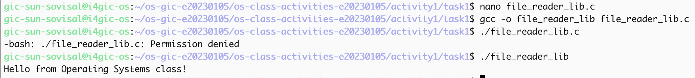

**Version B — POSIX System Calls (`file_reader_sys.c`):**

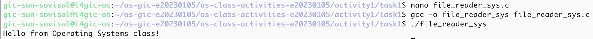

**Questions:**

1. **What does `read()` return? How is this different from `fgets()`?**

   > `read()` returns the number of bytes actually read, `0` at end of file, or `-1` on error. It does not stop at newlines; it just fills the buffer up to the requested size. `fgets()` returns a `char*` to the buffer (or `NULL` on EOF/error) and stops at a newline or when the buffer is full, so it is line-oriented rather than raw-byte oriented.

2. **Why do you need a loop when using `read()`? When does it stop?**

   > One `read()` may return fewer bytes than the file size (or than your buffer). The loop keeps reading until `read()` returns `0`, which means end of file. That way the whole file is displayed even if it is larger than the buffer.

---

## Task 2: Directory Listing & File Info

**Describe your implementation:** Both versions walk the current directory with `opendir` / `readdir` / `stat`. Version A prints with `printf`. Version B formats each line with `snprintf` into a buffer, then outputs it with `write(1, ...)`. The listing format (filename + size) matches.

### Version A — Library Functions (`dir_list_lib.c`)

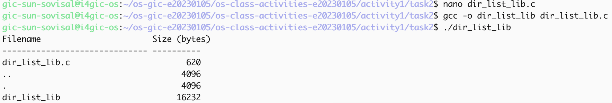

### Version B — System Calls (`dir_list_sys.c`)

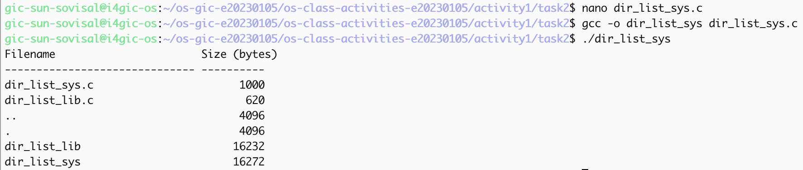

### Questions

1. **What struct does `readdir()` return? What fields does it contain?**

   > `readdir()` returns a pointer to `struct dirent`. Useful fields include `d_name` (entry name), and on Linux also `d_ino` (inode number), `d_type` (file type hint), and `d_reclen` / `d_off` for directory-record details.

2. **What information does `stat()` provide beyond file size?**

   > Beyond `st_size`, `stat()` fills mode/permissions (`st_mode`), owner/group IDs, link count, inode number, device IDs, and timestamps (`st_atime`, `st_mtime`, `st_ctime`). You can also tell whether the entry is a regular file, directory, symlink, etc. from `st_mode`.

3. **Why can't you `write()` a number directly — why do you need `snprintf()` first?**

   > `write()` sends raw bytes. An integer like `fileStat.st_size` is binary in memory, not the ASCII digits you want on the terminal. `snprintf()` converts the number (and the filename) into a printable string first; then `write()` can send those characters.

---

## Task 3: strace Analysis

**Describe what you observed:** With `strace -c` on the file creator, the library version made **38** total system calls and the syscall version made **34**. When filtered to `openat,read,write,close`, both versions look very similar for creating the file: one `openat` on `output.txt`, one `write` of 36 bytes, one `close`, then one `write` of the success message. The library path still shows extra setup work in the full `-c` summary (`brk`, more `fstat`, etc.). One clear detail: library `fopen(..., "w")` ended up with mode `0666` (before umask), while my `open(..., 0644)` used `0644` directly.

### strace Output — Library Version (File Creator)

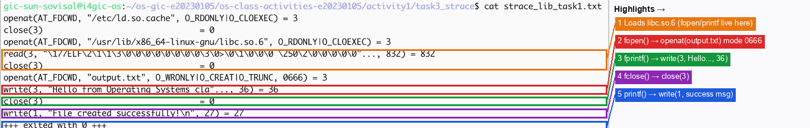

### strace Output — System Call Version (File Creator)

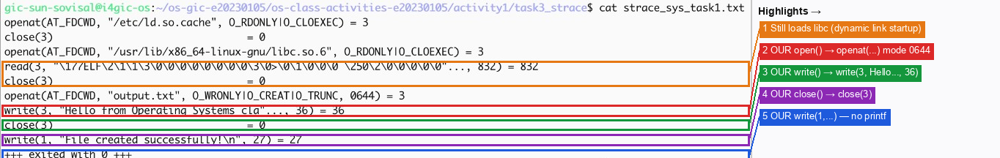

### strace Output — Library Version (File Reader)

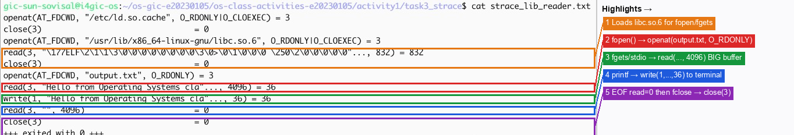

### strace Output — System Call Version (File Reader)

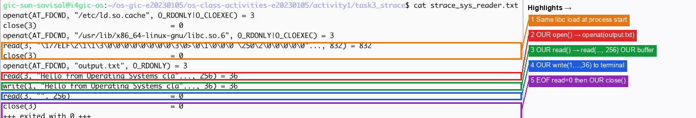

### strace -c Summary Comparison

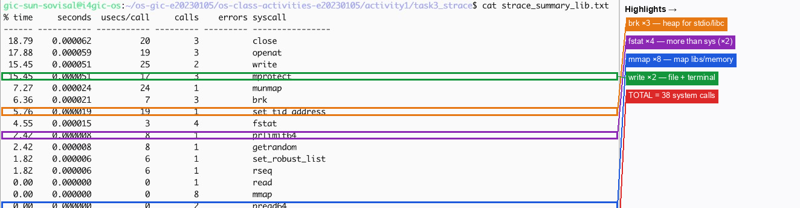
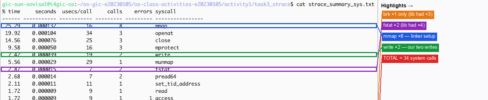

### Questions

1. **How many system calls does the library version make compared to the system call version?**

   > From `strace -c` on the file creator: library version = **38** calls total; system call version = **34** calls total. The library version made a few more calls (about 4 more in this run).

2. **What extra system calls appear in the library version? What do they do?**

   > The library summary shows more `brk` calls (3 vs 1) and more `fstat` calls (4 vs 2). `brk` grows the process heap, which stdio uses for buffering. `fstat` lets the C library query file status (for example after opening) as part of setting up the `FILE*` stream. Both versions still do dynamic linker work (`openat`/`mmap` for `libc.so.6`), but the library I/O path does more heap/stream bookkeeping.

3. **How many `write()` calls does `fprintf()` actually produce?**

   > For writing the single short string to `output.txt`, `strace` shows **one** `write()` of 36 bytes. That matched what I expected for one short `fprintf`: the data is buffered and flushed as one write when the stream is closed (or the buffer is flushed), not one kernel write per character.

4. **In your own words, what is the real difference between a library function and a system call?**

   > A system call is a request that crosses into the kernel (for example `open`, `read`, `write`). A library function like `fprintf` or `fopen` is user-space code that may buffer, format, and manage state, and then eventually invoke one or more system calls for you. So libraries are a convenience layer; the kernel still does the real I/O through system calls.

---

## Task 4: Exploring OS Structure

### System Information

> 📸 Screenshot of `uname -a`, `/proc/cpuinfo`, `/proc/meminfo`, `/proc/version`, `/proc/uptime`:

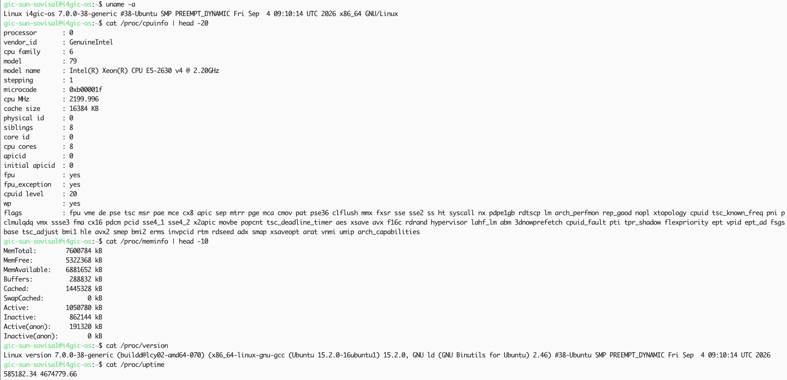

### Process Information

> 📸 Screenshot of `/proc/self/status`, `/proc/self/maps`, `ps aux`:

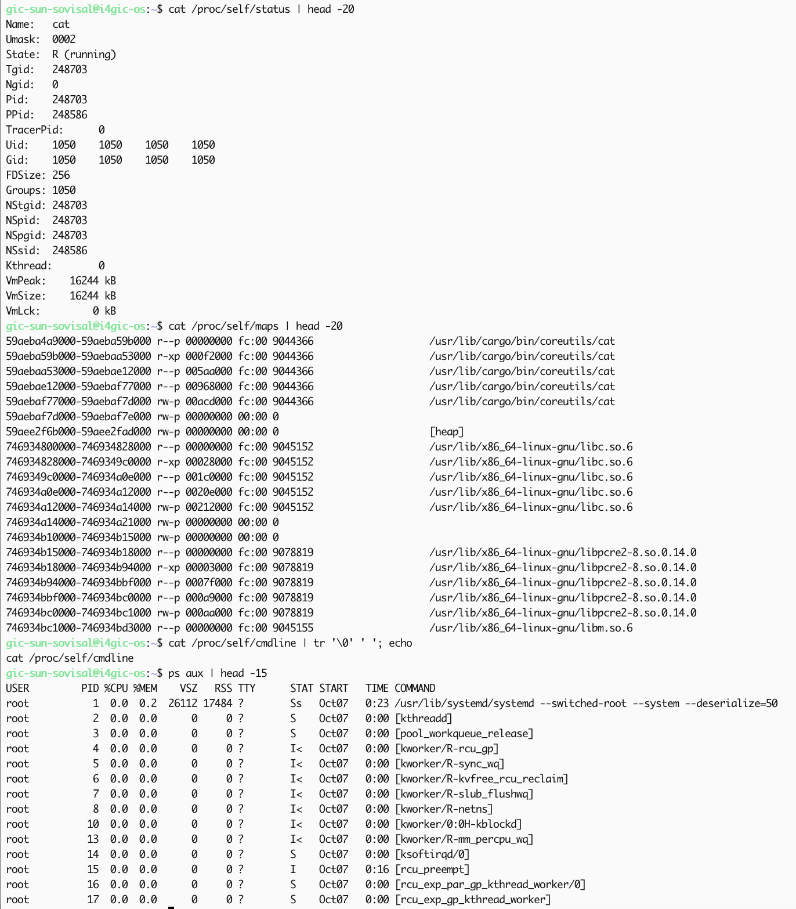

### Kernel Modules

> 📸 Screenshot of `lsmod` and `modinfo`:

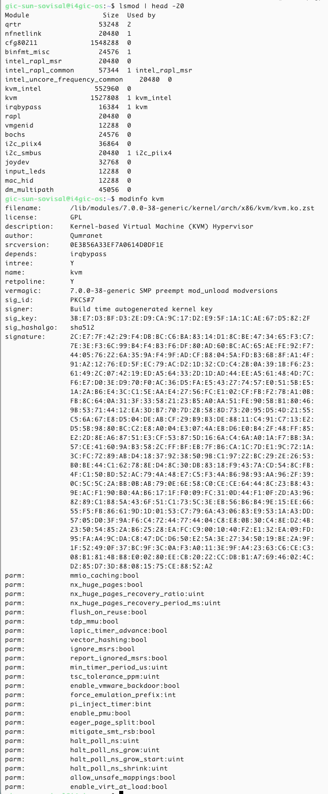

### OS Layers Diagram

> 📸 Diagram of the OS layers, labeled with data from this system:

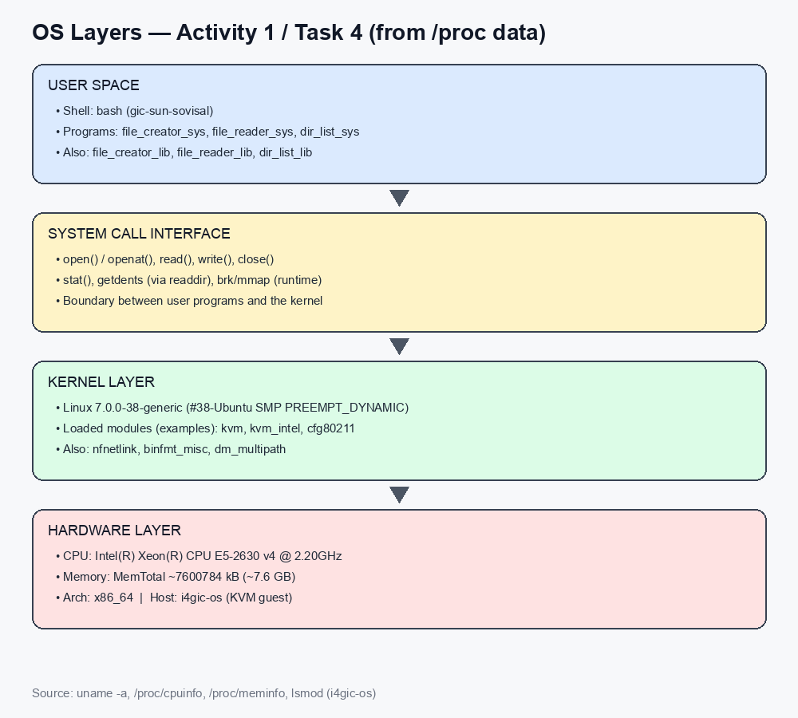

### Questions

1. **What is `/proc`? Is it a real filesystem on disk?**

   > `/proc` is a virtual filesystem. It is not a normal on-disk directory of static files. When you read entries like `/proc/cpuinfo` or `/proc/self/status`, the kernel generates the content on the fly from its current internal state.

2. **Monolithic kernel vs. microkernel — which type does Linux use?**

   > A monolithic kernel runs most OS services (scheduling, memory, drivers, filesystems) in kernel space as one large kernel. A microkernel keeps only a small core in kernel space and runs many services as user-space servers. Linux is **monolithic** (with loadable modules). `lsmod` shows many modules (`kvm`, `kvm_intel`, `cfg80211`, …) loaded into the same kernel address space, which fits the modular monolithic design.

3. **What memory regions do you see in `/proc/self/maps`?**

   > I saw the executable mapping for `cat`, the `[heap]` region, shared libraries such as `libc.so.6`, `libm.so.6`, and `libpcre2-8.so.0`, plus other anonymous/mapped regions with permissions like `r-xp` and `rw-p`. (Stack often appears lower in the full maps output as `[stack]`.)

4. **Break down the kernel version string from `uname -a`.**

   > Example: `Linux i4gic-os 7.0.0-38-generic #38-Ubuntu SMP PREEMPT_DYNAMIC Fri Sep 4 09:10:14 UTC 2026 x86_64 GNU/Linux`
   > - `Linux` — kernel name
   > - `i4gic-os` — hostname
   > - `7.0.0-38-generic` — kernel release (version + Ubuntu package revision + flavor)
   > - `#38-Ubuntu` — build number for this Ubuntu kernel package
   > - `SMP PREEMPT_DYNAMIC` — SMP-capable, dynamically preemptible kernel
   > - date — when that kernel was built
   > - `x86_64` — machine architecture
   > - `GNU/Linux` — OS description

5. **How does `/proc` show that the OS is an intermediary between programs and hardware?**

   > User programs do not talk to the CPU or RAM chips directly to learn status. They open `/proc` files and the kernel fills in values it already tracks (CPU model, memory totals, process maps, loaded modules). That shows the kernel sits between applications and hardware: hardware state is collected and exposed only through the OS interface.

---

## Reflection

What did you learn from this activity? What was the most surprising difference between library functions and system calls?

> I learned that familiar C library calls are wrappers around lower-level POSIX system calls, and that you can do the same file I/O with `open`/`read`/`write`/`close` if you manage buffers and lengths yourself. The most surprising part from `strace` was how similar the filtered file I/O looked for both versions, while the full `strace -c` still showed extra library bookkeeping (`brk`, more `fstat`). Also, `fprintf` of one short string became a single `write`, which made buffering concrete instead of abstract.
