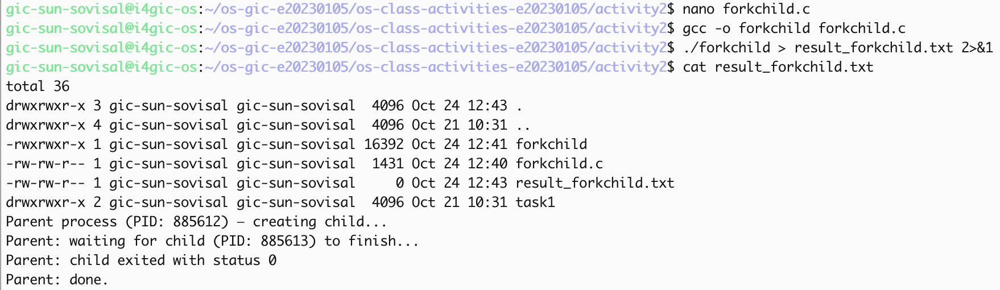
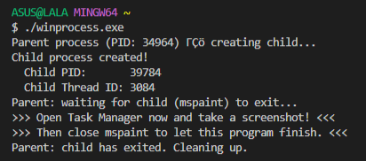
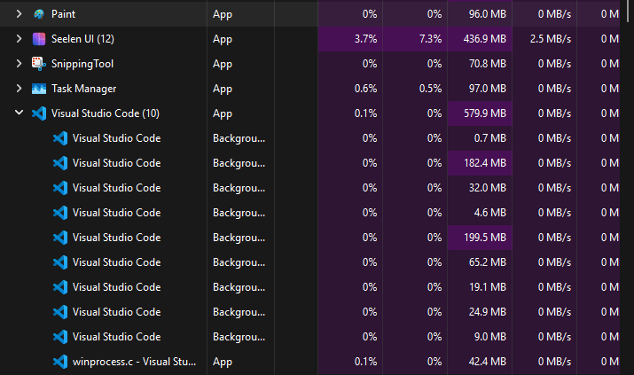
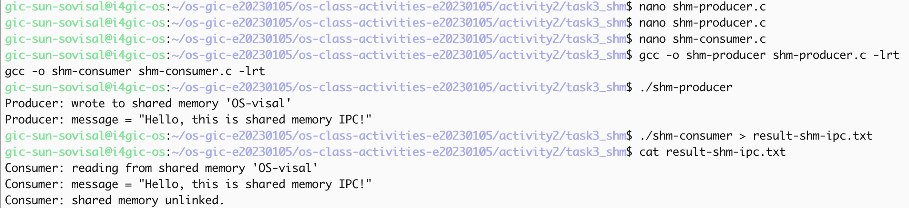
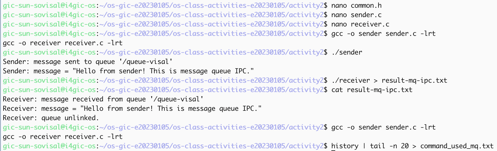

# Class Activity 2 — Processes & Inter-Process Communication

- **Student Name:** SUN SOVISAL
- **Student ID:** e20230105
- **Date:** 2026-10-24

---

## Task 1: Process Creation on Linux (fork + exec)

### Compilation & Execution

Screenshot of compiling and running `forkchild.c`:



### Process Tree

Screenshot of the parent-child process tree (using `ps --forest`, `pstree`, or `htop` tree view):


### Output

```
total 36
drwxrwxr-x 3 gic-sun-sovisal gic-sun-sovisal  4096 Oct 24 12:44 .
drwxrwxr-x 4 gic-sun-sovisal gic-sun-sovisal  4096 Oct 21 10:31 ..
-rwxrwxr-x 1 gic-sun-sovisal gic-sun-sovisal 16392 Oct 24 12:41 forkchild
-rw-rw-r-- 1 gic-sun-sovisal gic-sun-sovisal  1431 Oct 24 12:40 forkchild.c
-rw-rw-r-- 1 gic-sun-sovisal gic-sun-sovisal     0 Oct 24 12:47 result_forkchild.txt
drwxrwxr-x 2 gic-sun-sovisal gic-sun-sovisal  4096 Oct 21 10:31 task1
Parent process (PID: 885774) — creating child...
Parent: waiting for child (PID: 885775) to finish...
Parent: child exited with status 0
Parent: done.
```

### Questions

1. **What does `fork()` return to the parent? What does it return to the child?**

   > The parent gets the child PID (`885775`). The child gets `0`. On failure it returns `-1`.

2. **What happens if you remove the `waitpid()` call? Why might the output look different?**

   > The parent no longer waits. It can print `Parent: done.` and exit while the child is still sleeping or running `ls`, so the listing can appear after the parent has finished, and the parent cannot print the exit status.

3. **What does `execlp()` do? Why don't we see "execlp failed" when it succeeds?**

   > `execlp("ls", "ls", "-la", NULL)` replaces the child with `ls`. On success it does not return, so `perror("execlp")` never runs. The `ls` listing and exit status `0` show that it worked.

4. **Draw the process tree for your program (parent → child). Include PIDs from your output.**

   > ```
   > bash (PID 885231)
   >   └── ./forkchild (PID 885774)
   >         └── ./forkchild (PID 885775) → becomes ls -la
   > ```

5. **Which command did you use to view the process tree (`ps --forest`, `pstree`, or `htop`)? What information does each column show?**

   > I used the `htop`/`top` tree view. It shows PID, user, priority, nice, VIRT, RES, SHR, state (`S` = sleeping), CPU, memory, time, and the command. The tree is `bash` 885231 → `./forkchild` 885774 → `./forkchild` 885775.

---

## Task 2: Process Creation on Windows

### Compilation & Execution

Screenshot of compiling and running `winprocess.c`:



### Task Manager Screenshots

Screenshot showing process tree in the **Processes** tab (mspaint nested under your program):



Screenshot showing PID and Parent PID in the **Details** tab:


### Questions

1. **What is the key difference between how Linux creates a process (`fork` + `exec`) and how Windows does it (`CreateProcess`)?**

   > Linux copies the process with `fork()`, then the child loads a new program with `exec()`. Windows does both in one `CreateProcess()` call, which started `mspaint.exe` directly.

2. **What does `WaitForSingleObject()` do? What is its Linux equivalent?**

   > It blocks the parent until Paint exits. On Linux that is `waitpid()`.

3. **Why do we need to call `CloseHandle()` at the end? What happens if we don't?**

   > `CreateProcess()` returns a process handle and a thread handle. `CloseHandle()` releases them. Skipping it leaves those handles open.

4. **In Task Manager, what was the PID of your parent program and the PID of mspaint? Do they match your program's output?**

   > Parent PID **34964**, mspaint PID **39784** (thread ID 3084). The Details tab shows `mspaint.exe` PID 39784, which matches the program output.

5. **Compare the Processes tab (tree view) and the Details tab (PID/PPID columns). Which view makes it easier to understand the parent-child relationship? Why?**

   > The Processes tab shows who started whom by nesting. The Details tab shows the PID numbers. The tree is easier to read; the Details tab is how I checked that mspaint’s PID is 39784.

---

## Task 3: Shared Memory IPC

### Compilation & Execution

Screenshot of compiling and running `shm-producer` and `shm-consumer`:



### Output

```
Consumer: reading from shared memory 'OS-visal'
Consumer: message = "Hello, this is shared memory IPC!"
Consumer: shared memory unlinked.
```

### Questions

1. **What does `shm_open()` do? How is it different from `open()`?**

   > `shm_open()` creates or opens a named shared-memory object (`OS-visal`). `open()` opens a normal file by path.

2. **What does `mmap()` do? Why is shared memory faster than other IPC methods?**

   > `mmap()` maps that object into the process so both programs use the same memory. No extra copy is made for each message.

3. **Why must the shared memory name match between producer and consumer?**

   > The name is how the kernel finds the object. Both programs use `OS-visal`. A different name would open a different object.

4. **What does `shm_unlink()` do? What would happen if the consumer didn't call it?**

   > `shm_unlink("OS-visal")` removes the shared-memory name. Without it, the object stays after both programs exit.

5. **If the consumer runs before the producer, what happens? Try it and describe the error.**

   > The object does not exist yet, so the consumer fails:

   > ```
   > shm_open: No such file or directory
   > Hint: Did you run shm-producer first?
   > ```

---

## Task 4: Message Queue IPC

### Compilation & Execution

Screenshot of compiling and running `sender` and `receiver`:



### Output

```
Receiver: message received from queue '/queue-visal'
Receiver: message = "Hello from sender! This is message queue IPC."
Receiver: queue unlinked.
```

### Questions

1. **How is a message queue different from shared memory? When would you use one over the other?**

   > Shared memory is one region both processes use directly. A message queue sends separate messages (`mq_send` / `mq_receive`). I would use shared memory for a large shared buffer, and a queue when I just need to pass one message.

2. **Why does the queue name in `common.h` need to start with `/`?**

   > POSIX queue names must start with `/`. Mine is `/queue-visal`, so both programs open the same queue.

3. **What does `mq_unlink()` do? What happens if neither the sender nor receiver calls it?**

   > `mq_unlink("/queue-visal")` removes the queue. If nobody calls it, the queue stays after both programs exit.

4. **What happens if you run the receiver before the sender?**

   > The receiver opens the queue without creating it, so `mq_open` fails and it prints `Hint: Did you run sender first?`

5. **Can multiple senders send to the same queue? Can multiple receivers read from the same queue?**

   > Yes. Several programs can send to `/queue-visal`, and several can receive. Each message is delivered to one receiver.

---

## Reflection

What did you learn from this activity? What was the most interesting difference between Linux and Windows process creation? Which IPC method do you prefer and why?

> Linux creates a process in two steps (`fork`, then `exec`). Windows does both with one `CreateProcess()` call. For a single text message I prefer the message queue, because the receiver just waits and reads it. Shared memory fits better when both processes keep using the same buffer.
