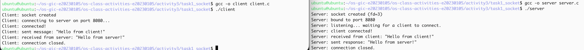
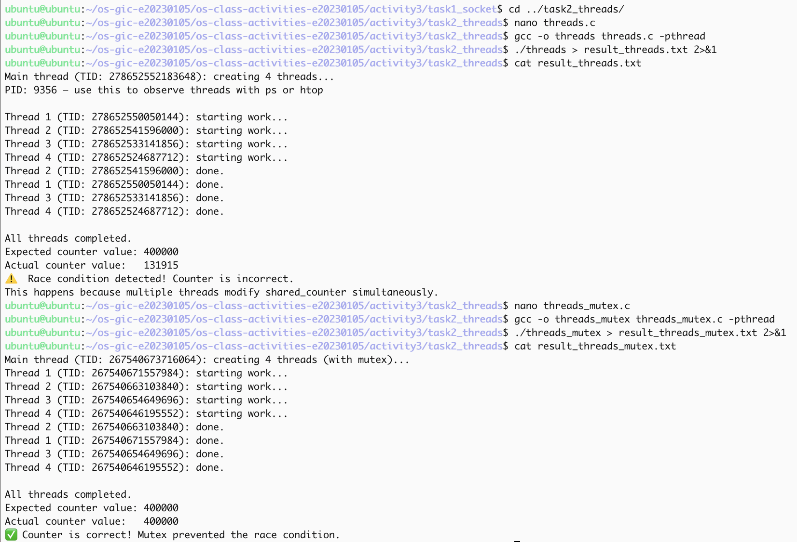
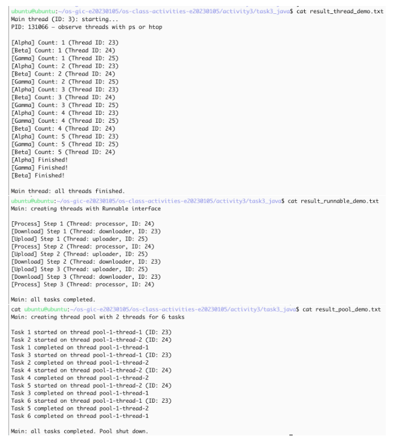
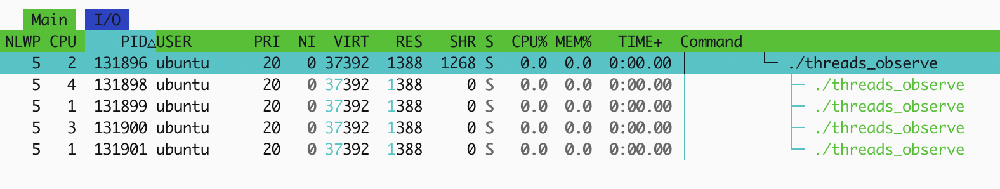
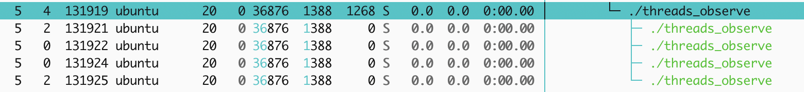

# Class Activity 3 — Socket Communication & Multithreading

- **Student Name:** SUN SOVISAL
- **Student ID:** e20230105
- **Date:** 2026-10-28

---

## Task 1: TCP Socket Communication (C)

### Compilation & Execution



The server and client exchanged one message on port 8080:

```
Server: socket created (fd=3)
Server: bound to port 8080
Server: listening... waiting for a client to connect.
Server: client connected!
Server: received from client: "Hello from client!"
Server: sent response: "Hello from server!"
Server: connection closed.
Client: socket created
Client: connecting to server on port 8080...
Client: connected!
Client: sent message: "Hello from client!"
Client: received from server: "Hello from server!"
Client: connection closed.
```

### Answers

1. **Role of `bind()` / Why client doesn't call it:**

   > `bind()` attaches the server socket to port 8080 on all interfaces (`INADDR_ANY`), so the client has a known address to connect to. The client does not call `bind()`. `connect()` to `127.0.0.1:8080` lets the kernel pick a temporary local port.

2. **What `accept()` returns:**

   > `accept()` returns a new socket for that one client. In this run the listening socket was fd 3. The new socket is a different fd, and the server uses it for `read()` and `send()`. The original socket stays in `listen()` and is closed only at the end.

3. **Starting client before server:**

   > In the saved run the server was started first, so `connect()` succeeded. If the client starts while nothing is listening on port 8080, `connect()` fails and `perror("connect")` prints `Connection refused`.

4. **What `htons()` does:**

   > `htons(8080)` converts the port from host byte order to network byte order (big-endian). The TCP header stores the port in network order. This machine is little-endian, so without `htons()` the other side would see the wrong port.

5. **Socket call sequence diagram:**

   > ```
   > Server                         Client
   > socket()                       socket()
   > bind(port 8080)
   > listen()
   > accept()  <------------------  connect(127.0.0.1:8080)
   > read()    <------------------  send("Hello from client!")
   > send("Hello from server!") --> read()
   > close()                        close()
   > ```

---

## Task 2: POSIX Threads (C)

### Output — Without Mutex (Race Condition)



```
Main thread (TID: 278652552183648): creating 4 threads...
PID: 9356 — use this to observe threads with ps or htop

Thread 1 (TID: 278652550050144): starting work...
Thread 2 (TID: 278652541596000): starting work...
Thread 3 (TID: 278652533141856): starting work...
Thread 4 (TID: 278652524687712): starting work...

Expected counter value: 400000
Actual counter value:   131915
Race condition detected! Counter is incorrect.
```

### Output — With Mutex (Correct)

```
Main thread (TID: 267540673716064): creating 4 threads (with mutex)...

Expected counter value: 400000
Actual counter value:   400000
Counter is correct! Mutex prevented the race condition.
```

### Answers

1. **What is a race condition?**

   > A race condition is when the result depends on the order in which threads run. `shared_counter++` is a read, add, and write. Four threads each do that 100000 times, so the expected value is 400000. Two threads can read the same value and both write it back, so one increment is lost. The actual value was 131915.

2. **What does `pthread_mutex_lock()` do?**

   > `pthread_mutex_lock()` lets only one thread enter the increment at a time. The others wait at `pthread_mutex_lock()` until `pthread_mutex_unlock()`. That removes the lost updates, so the counter finished at 400000.

3. **Removing `pthread_join()`:**

   > `pthread_join()` makes `main` wait until each worker returns. Without it, `main` can print the counter and `return 0` while the workers are still inside the loop. The process then exits and the remaining threads are destroyed, so the counter is even smaller and some `done` lines never appear.

4. **Thread vs Process:**

   > A process has its own address space and PID. Threads of one process share the code, the heap, and global data such as `shared_counter`. Each thread has its own stack, registers, and thread ID (`pthread_self()`). That is why the four workers could change one counter, and why they needed a mutex.

---

## Task 3: Java Multithreading

### ThreadDemo Output



```
Main thread (ID: 3): starting...
PID: 131066 — observe threads with ps or htop

[Alpha] Count: 1 (Thread ID: 23)
[Beta] Count: 1 (Thread ID: 24)
[Gamma] Count: 1 (Thread ID: 25)
...
[Alpha] Finished!
[Gamma] Finished!
[Beta] Finished!

Main thread: all threads finished.
```

Alpha, Beta, and Gamma printed in mixed order. Their thread IDs were 23, 24, and 25.

### RunnableDemo Output

```
Main: creating threads with Runnable interface

[Process] Step 1 (Thread: processor, ID: 24)
[Download] Step 1 (Thread: downloader, ID: 23)
[Upload] Step 1 (Thread: uploader, ID: 25)
...
Main: all tasks completed.
```

### PoolDemo Output

```
Main: creating thread pool with 2 threads for 6 tasks

Task 1 started on thread pool-1-thread-1 (ID: 23)
Task 2 started on thread pool-1-thread-2 (ID: 24)
Task 1 completed on thread pool-1-thread-1
Task 3 started on thread pool-1-thread-1 (ID: 23)
...
Main: all tasks completed. Pool shut down.
```

Only `pool-1-thread-1` and `pool-1-thread-2` ran the six tasks. A new task started after one of those two finished.

### Answers

1. **Thread vs Runnable:**

   > `ThreadDemo` subclasses `Thread` (`CounterThread`) and calls `start()`. `RunnableDemo` puts the work in `PrintTask implements Runnable` and passes that object to `new Thread(...)`. `Runnable` is the better default: the class can still extend another class, and the same task can be given to a thread or to `ExecutorService`. Extending `Thread` fits only when the class itself is the thread.

2. **Pool size limiting concurrency:**

   > `Executors.newFixedThreadPool(2)` creates two worker threads. Six tasks are submitted, but the other four wait in the pool queue. The output shows task 3 starting only after task 1 finishes on `pool-1-thread-1`, and task 4 starting after task 2 finishes on `pool-1-thread-2`.

3. **thread.join() in Java:**

   > `join()` blocks the caller until that thread's `run()` returns. In `ThreadDemo`, `main` prints `all threads finished` only after Alpha, Beta, and Gamma have finished. Without the three `join()` calls, `main` would print that line while the counters were still running. The three threads would still finish, because they are not daemon threads, so the JVM stays up until they end.

4. **ExecutorService advantages:**

   > A pool reuses a small number of threads instead of creating one thread per task. Extra tasks wait in a queue, `shutdown()` stops new work, and `awaitTermination()` waits for the queued tasks. That is easier to control than calling `new Thread()` for every job.

---

## Task 4: Observing Threads

`threads_observe` creates one main thread and four workers, then sleeps so the threads stay visible. `htop` shows five rows, all with `NLWP` 5. The main thread's ID is the process PID.

### Linux — `ps -eLf` Output

Saved in `task2_threads/result_observe_linux.txt`. The same five threads are in `screenshots/task4_htop_threads.png`. Every row has PID 131896 and `NLWP` 5. The LWP values are the thread IDs:

```
  PID     LWP NLWP PSR STAT COMMAND
131896  131896    5   2 S    threads_observe
131896  131898    5   4 S    threads_observe
131896  131899    5   1 S    threads_observe
131896  131900    5   3 S    threads_observe
131896  131901    5   1 S    threads_observe
```

`/proc/131896/task/` lists those same five IDs. The main thread ID equals the PID, 131896.

### Linux — htop Thread View



### Linux — htop Kernel Threads (tree view, `kthreadd`)



This second capture is another run of `./threads_observe`, not the `kthreadd` tree. Its thread IDs are 131919 (main), 131921, 131922, 131924, and 131925. `NLWP` is again 5. CPU cores in that run were 4, 2, 0, 0, and 2.

### Linux — Kernel Threads (commands)

`ps -L -o pid,lwp,nlwp,psr,stat,comm -p 131896` is in `task2_threads/result_observe_linux.txt`. It shows `NLWP` 5 and the main thread ID equal to the PID. `ps --ppid 2` is not in that file. The htop capture below is still `./threads_observe`, so `kthreadd` is not in the saved screenshot.

### Windows — Task Manager


`java.exe` (OpenJDK), PID 92188, user ASUS, status Running, memory 194,904 K, **Threads: 85**.

### Answers

1. **LWP column meaning:**

   > LWP means light-weight process. It is the kernel's thread ID. In `ps -eLf` every thread is one row: the PID stays the same and the LWP changes. In the `htop` screenshot the PID column is that thread ID. Process 131896 has LWPs 131896, 131898, 131899, 131900, and 131901.

2. **/proc/PID/task/ count:**

   > `/proc/131896/task/` has one directory per thread, named with the thread ID. The count is 5, the same as `NLWP` and the same as the program: the main thread plus the four workers. The directory names are 131896, 131898, 131899, 131900, and 131901.

3. **Extra Java threads:**

   > `ThreadDemo` starts three threads (Alpha, Beta, Gamma) plus `main`. Task Manager shows 85 threads for `java.exe` PID 92188. The extra threads belong to the JVM: garbage collection, the JIT compiler, the reference handler, the finalizer, the signal dispatcher, and other runtime threads.

4. **Linux vs Windows thread viewing:**

   > Linux shows each thread. `htop` and `ps -eLf` give a row per thread with its ID, state, and CPU, and `/proc/<pid>/task/` lists the IDs. Task Manager shows one row for `java.exe` and a Threads count (85). Linux gives more detail about each thread. Task Manager is enough to see that the JVM has many more threads than the three the program created.

5. **kthreadd and three kernel threads:**

   > `kthreadd` is the parent of the kernel's own threads, and its PID is 2. Kernel threads have no user address space. `ps` prints their names in square brackets, for example `[ksoftirqd/0]`, `[rcu_sched]`, and `[kworker/...]`, and they appear as children of PID 2. In `htop`, `K` shows them and `F5` puts them under `kthreadd`. The file `task4_htop_kernel_threads.png` still shows `./threads_observe`, so those three kernel threads are not in the saved screenshot.

6. **TID equal to PID, NLWP and cores:**

   > The thread whose ID equals the PID is the main thread: 131896. `NLWP` is 5 on every row. In that `htop` view the cores (PROCESSOR / CPU) were 2 for the main thread, then 4, 1, 3, and 1 for the four workers. All five were in state `S` (sleeping).

7. **`H` and `K` in htop:**

   > `H` shows or hides the threads of each user process. Without it, `./threads_observe` is one row instead of five. `K` shows or hides kernel threads. Without it, `kthreadd` and threads such as `ksoftirqd` stay hidden even though they are still running.

---

## Reflection

> The socket task is a fixed order of calls: the server must `bind` and `listen` before the client can `connect`, and `accept` creates a second socket just for that conversation. Threads are different from that. The four C workers share `shared_counter`, so the result was 131915 until a mutex made the increment one thread at a time. Seeing the same program as five rows in `htop`, all with one PID and `NLWP` 5, makes that concrete: the kernel schedules threads, while the process is the shared address space. On Windows the same idea shows up as a thread count on `java.exe`, except the JVM adds its own threads, so the count was 85 rather than the three threads in `ThreadDemo`.
