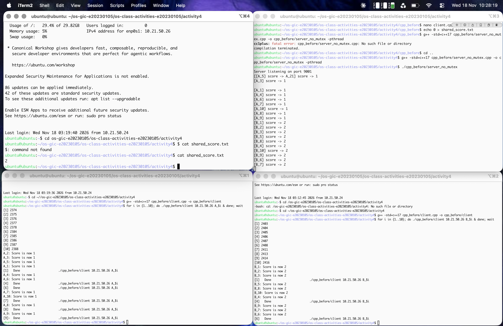
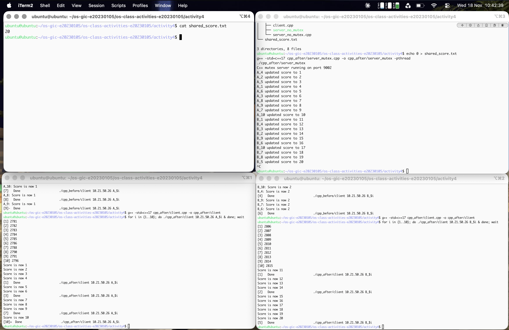
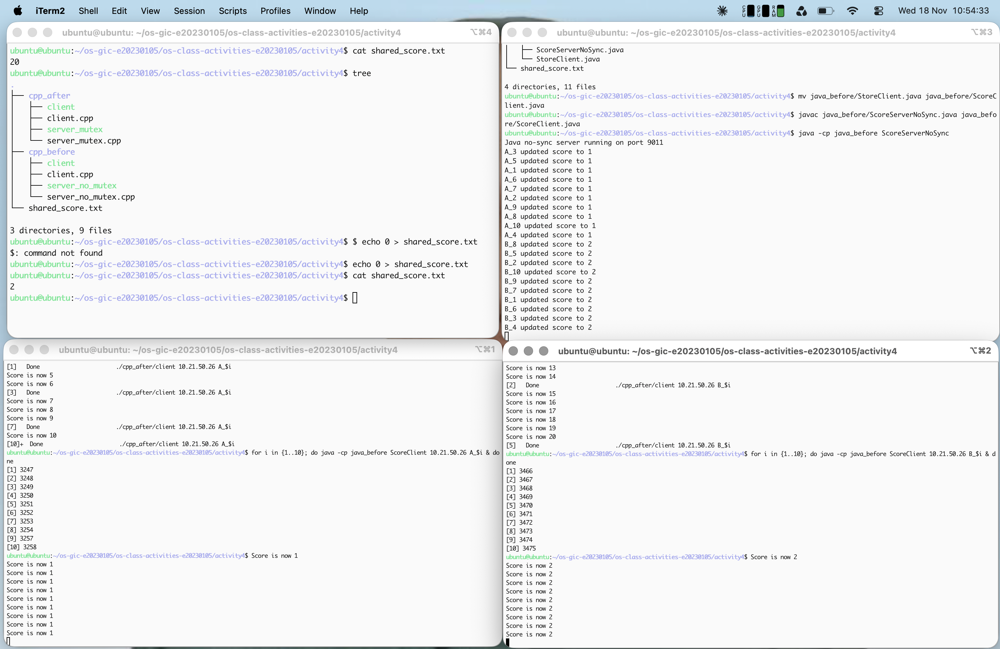
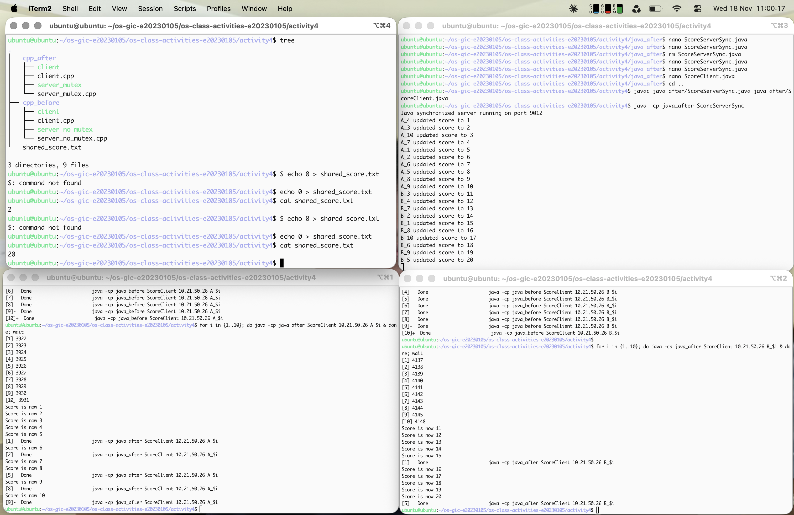

# Class Activity 4 — Shared File API

- **Student Name:** SUN SOVISAL
- **Student ID:** e20230105
- **Partner Name:** N/A (solo)
- **Partner Student ID:** N/A (solo)
- **Server Machine Owner:** SUN SOVISAL
- **Server IP Address:** 10.21.50.26
- **Date:** 2026-11-18

> **Solo setup:** I did this activity alone. One Ubuntu VM ran the server, and I simulated Student A and Student B as two separate client terminals on the same machine. Both clients connected to the server's LAN IP (`10.21.50.26`), not `localhost`. A fourth terminal checked `shared_score.txt`. Each run started from `echo 0 > shared_score.txt`. Student A sent 10 requests (`A_1` … `A_10`) and Student B sent 10 requests (`B_1` … `B_10`).

| Version | Port |
|---|---|
| C++ before mutex | 9001 |
| C++ after mutex | 9002 |
| Java before synchronized | 9011 |
| Java after synchronized | 9012 |

---

## Task 1: C++ Before Mutex

- **Expected score:** 20
- **Actual score:** 2

**What happened:**

> The server starts a new thread for each client. Each thread reads `shared_score.txt`, sleeps 200 ms, adds 1, and writes the file back. Nothing stops the threads from overlapping. All 10 `A_*` threads read `0` before any of them wrote, so each wrote `1` and the server log shows `score -> 1` ten times. Student B's batch started after A's had finished, so all 10 `B_*` threads read `1` and wrote `2`. The server handled 20 requests, but 18 updates were lost because threads overwrote each other's writes.

---

## Task 2: C++ After Mutex

- **Expected score:** 20
- **Actual score:** 20

**What changed after adding mutex:**

> I added a global `std::mutex` and a `std::lock_guard<std::mutex>` at the start of the score update. Now only one thread at a time can do the read, sleep, increment, and write. The server log counts up in order from `A_4 updated score to 1` to `B_5 updated score to 20`, and every client got a different score back. The run is slower because the 20 updates now happen one after another (about 20 × 200 ms), but no update is lost. The order inside each batch (`A_4, A_2, A_5, …`) is still decided by the scheduler. The mutex controls *exclusive access*, not *order*.

---

## Task 3: Java Before Synchronized

- **Expected score:** 20
- **Actual score:** 2

**What happened:**

> The Java server has the same bug. `main()` starts a new `Thread` for each accepted socket, and `updateScore()` is not synchronized. The 10 `A_*` threads all read `0` and wrote `1` (`updated score to 1` ten times). The 10 `B_*` threads all read `1` and wrote `2`. Java threads are real OS threads, so they run at the same time just like the C++ threads, and the result is the same lost update.

---

## Task 4: Java After Synchronized

- **Expected score:** 20
- **Actual score:** 20

**What changed after adding synchronized:**

> The only change was adding the `synchronized` keyword to the score update method. A thread must hold the object's built-in lock (monitor) before it can enter the method, so the other threads wait. The server log goes from `A_4 updated score to 1` up to `B_5 updated score to 20` with no repeated values, and `cat shared_score.txt` shows `20`.

---

## Questions

1. **Why should clients send requests to the server instead of writing the file directly?**

   > If every client opened and wrote `shared_score.txt` itself, there would be no single place to control access, and clients on other machines can't even reach the file. With a server, the file has one owner. Clients only send a request (`A_1`), and the server decides how and when the file is changed. That gives one place to add the lock, validate input, and keep the rule "each request adds exactly 1."

2. **Why does the server still have a race condition before mutex or synchronized?**

   > Having a server doesn't make the requests run one at a time. The server creates one thread per client, and those threads run at the same time inside the same process. Updating the file takes three steps (read, increment, write) with a 200 ms sleep in the middle. Two threads can read the same old value and both write `old + 1`, so one update is lost. In my runs, 10 threads read the same value each time, which is why the result was 2 instead of 20.

3. **In the C++ fixed version, what does `std::lock_guard<std::mutex>` protect?**

   > It protects the critical section: the whole read, sleep, increment, and write of `shared_score.txt`. `lock_guard` locks the mutex when it is created and unlocks it automatically when it goes out of scope at the end of the function (RAII), even if the function returns early. Only one thread can be inside that section at a time. The socket accept and the reply to the client are outside the lock, so they can still run in parallel.

4. **In the Java fixed version, what does `synchronized` protect?**

   > It protects the whole score update method. Before a thread can run a `synchronized` method, it must take the monitor lock of the object, or of the class for a `static` method. Every client thread uses the same lock, so only one thread at a time can read, increment, and write the file. Java releases the lock automatically when the method returns or throws.

5. **Why is the final score expected to be 20 when Student A sends 10 requests and Student B sends 10 requests?**

   > The file starts at 0, and each request adds exactly 1. There are 10 + 10 = 20 requests, so if every update is applied the final value is 0 + 20 = 20. Any value below 20 means some updates were lost.

6. **What could happen if two separate servers update the same file at the same time?**

   > The race condition would come back even if each server has its own mutex or `synchronized` method. Those locks exist only inside one process's memory, so server 1 cannot see server 2's lock. Both servers could read the same value and write `old + 1`, losing updates again, or one server could read the file while the other is in the middle of writing it. To fix it, you need a lock that works across processes (for example `flock()` on the file, or a database with transactions), or only one server should own the file.

---

## Reflection

> C++ and Java solve the same problem in different ways. In C++ the lock is explicit: I declare a `std::mutex` and use a `std::lock_guard` to lock it for the length of the update, and RAII makes sure it is always released. In Java every object already has a lock, and the `synchronized` keyword takes it and releases it for me, so the fix was one word. The C++ version gives more control, because I choose exactly which lines are locked. The Java version is harder to get wrong. In both languages the result went from 2 to 20, and in both the cost was that the 20 updates now run one after another.
>
> The main lesson is that putting a server in front of a shared resource is not enough. The server's own threads still compete for the file, so every read-modify-write on shared data needs a lock. A lock also only protects the resource inside the program that holds it. If another process can touch the same file, I need a lock that both processes can see. It was also useful to see the lost updates directly in the log: ten lines of `score -> 1` show exactly how threads overwrite each other.
